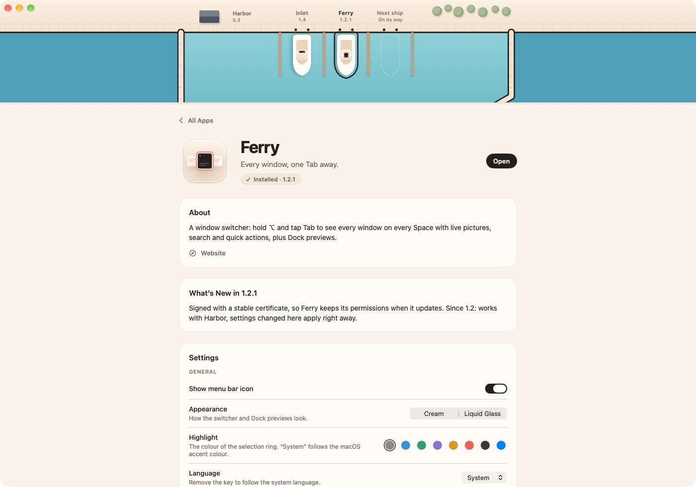

<p align="center">
  
</p>

<h1 align="center">Harbor</h1>

<p align="center">
  <b>All your Harbor apps, one quiet place.</b><br>
  A free, open-source hub for the Harbor Mac apps: see them all, hear about updates,<br>
  and change their settings in one window.
</p>

<p align="center">
  <a href="https://github.com/Kaandis/harbor/releases/latest"></a>
  
  <a href="LICENSE"></a>
</p>

<p align="center">
  <a href="https://kaandis.github.io/harbor/">Website</a> ·
  <a href="https://github.com/Kaandis/harbor/releases/latest/download/Harbor.zip">Download</a> ·
  <a href="README.tr.md">Türkçe</a>
</p>

<p align="center">
  
</p>

## What it does

- **Every app at a glance.** [Inlet](https://kaandis.github.io/inlet/) and [Ferry](https://kaandis.github.io/ferry/), and whatever comes next: installed, current, or waiting for you.
- **One-click installs and updates.** **Install** and **Update** download the app’s release from GitHub, check it against the catalog’s SHA-256, quit the app if it’s running, swap it in place and open it again. **Update All** does every app at once, and Harbor updates itself the same way.
- **Settings in one place.** Each app ships a `settings-schema.json` describing its preferences. Harbor draws them and the app applies a change at once.
- **Permissions at a glance.** Apps report which permissions they have, so you can see what’s missing.
- **Links from the apps.** An app’s **Settings…** menu item opens its Harbor page (`harbor://app/ferry`) when Harbor is installed.

<p align="center">
  
</p>

## Why it works this way

- **A harbour, not a store.** No accounts and no background updater: nothing is installed until you press the button, and every download is checked against the catalog before it touches your Applications folder.
- **The app owns its settings.** Values live in each app’s own preferences, described by a schema the app ships, so the app works the same with or without Harbor. Harbor writes the value, then posts `app.harbor.settingsChanged`; the app picks it up through [HarborKit](https://github.com/Kaandis/harbor-kit).
- **Only what you ask for from the internet.** Harbor learns the latest versions from [`catalog.json`](https://kaandis.github.io/harbor/catalog.json) on its website, at most every 12 hours or when you press **Check for Updates**, and downloads a release only when you press Install or Update. It sends nothing.
- **Quiet.** With its window in the background Harbor used 0.01 s of CPU over 30 seconds on an M4 Pro, with no wakeups. Closing the window quits it.

## Install

1. Download **[Harbor.zip](https://github.com/Kaandis/harbor/releases/latest/download/Harbor.zip)** and unzip it.
2. Move **Harbor.app** to Applications.
3. The first time, right-click Harbor and choose **Open** (builds aren’t notarized yet), or run:

```bash
xattr -dr com.apple.quarantine /Applications/Harbor.app
```

Harbor needs no special permissions. Apps it installs land in /Applications. Until builds are notarized, an updated app has a new signature, so macOS asks once more for permissions such as Accessibility.

## For app makers

A Harbor app:

1. keeps every setting as a plain `UserDefaults` key and describes them in `Resources/settings-schema.json` (see [Ferry’s](https://github.com/Kaandis/ferry/blob/main/Ferry/Resources/settings-schema.json));
2. calls `SettingsBridge.listen()` at launch, and optionally `SettingsBridge.publishPermissions(_:)`;
3. opens `HarborLink.openSettings(appID:)` from its Settings menu item, falling back to its own window;
4. is listed in [`docs/catalog.json`](docs/catalog.json) with its release zip and that zip’s SHA-256 (`shasum -a 256 App.zip`).

## Signing

Releases are built with `scripts/release.sh`, which signs them with the same self-signed “Harbor Apps Code Signing” certificate every time. A stable signature means macOS keeps the permissions people granted when an app updates; ad-hoc signed builds would lose them. Notarized Developer ID builds will replace this.

## Build from source

```bash
brew install xcodegen
git clone https://github.com/Kaandis/harbor.git
cd harbor
xcodegen generate
open Harbor.xcodeproj
```

## Disclaimer

Harbor is an independent project and is not affiliated with, endorsed by or sponsored by Apple Inc. Mac and macOS are trademarks of Apple Inc., registered in the U.S. and other countries.

## License

[MIT](LICENSE)
