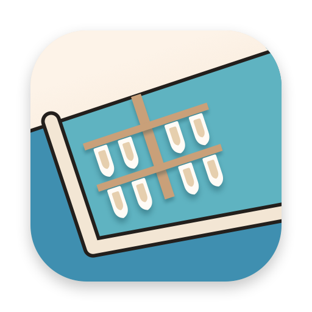
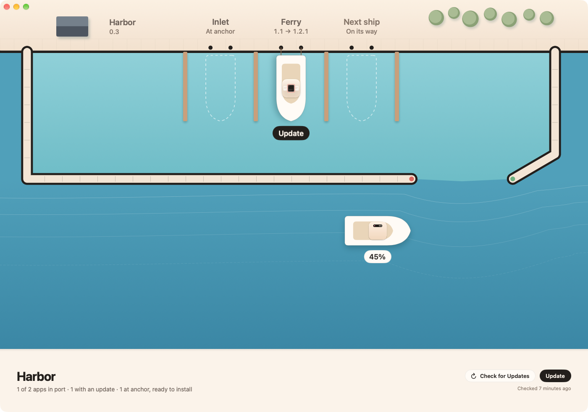

<p align="center">
  
</p>

<h1 align="center">Harbor</h1>

<p align="center">
  <b>Tüm Harbor uygulamaların, tek sakin bir yerde.</b><br>
  Harbor Mac uygulamaları için ücretsiz ve açık kaynak bir merkez: hepsini gör, güncellemelerden haberdar ol,<br>
  ayarlarını tek pencereden değiştir.
</p>

<p align="center">
  <a href="https://kaandis.github.io/harbor/">Web sitesi</a> ·
  <a href="https://github.com/Kaandis/harbor/releases/latest/download/Harbor.zip">İndir</a> ·
  <a href="README.md">English</a>
</p>

<p align="center">
  
</p>

## Ne yapar

- **Her uygulama bir bakışta.** [Inlet](https://kaandis.github.io/inlet/), [Ferry](https://kaandis.github.io/ferry/) ve sıradakiler: kurulu mu, güncel mi, seni mi bekliyor.
- **Tek tıkla kurulum ve güncelleme.** **Kur** ve **Güncelle**, uygulamanın GitHub sürümünü indirir, katalogdaki SHA-256 ile doğrular, açıksa uygulamayı kapatır, yerinde değiştirir ve yeniden açar. **Tümünü Güncelle** hepsini birden yapar; Harbor kendini de aynı yolla günceller.
- **Ayarlar tek yerde.** Her uygulama tercihlerini tarif eden bir `settings-schema.json` ile gelir. Harbor onları çizer, uygulama değişikliği anında uygular.
- **İzinler bir bakışta.** Uygulamalar hangi izinlere sahip olduklarını bildirir, eksik olanı görürsün.
- **Uygulamalardan bağlantı.** Harbor kuruluysa bir uygulamanın **Ayarlar…** menüsü Harbor’daki sayfasını açar (`harbor://app/ferry`).

## Neden böyle çalışıyor

- **Mağaza değil, bir liman.** Hesap yok, arka planda güncelleyici yok: sen düğmeye basmadan hiçbir şey kurulmaz, her indirme Uygulamalar klasörüne dokunmadan önce katalogla doğrulanır.
- **Ayarlar uygulamanın kendisinde.** Değerler her uygulamanın kendi tercihlerinde durur ve uygulamanın getirdiği şemayla tarif edilir; uygulama Harbor olsa da olmasa da aynı çalışır. Harbor değeri yazar, sonra `app.harbor.settingsChanged` bildirimini gönderir; uygulama bunu [HarborKit](https://github.com/Kaandis/harbor-kit) üzerinden alır.
- **İnternetten yalnızca istediğin.** Harbor son sürümleri sitesindeki [`catalog.json`](https://kaandis.github.io/harbor/catalog.json) dosyasından öğrenir (en fazla 12 saatte bir ya da **Güncellemeleri Denetle**’ye bastığında) ve bir sürümü yalnızca Kur ya da Güncelle’ye bastığında indirir. Hiçbir şey göndermez.
- **Sessiz.** Penceresi arka plandayken M4 Pro’da 30 saniyede 0,01 sn CPU kullandı, hiç uyanmadı. Pencereyi kapatınca Harbor da kapanır.

## Kurulum

1. **[Harbor.zip](https://github.com/Kaandis/harbor/releases/latest/download/Harbor.zip)**’i indir ve aç.
2. **Harbor.app**’i Uygulamalar’a taşı.
3. İlk seferde Harbor’a sağ tıklayıp **Aç**’ı seç (sürümler henüz notarize edilmedi) ya da şunu çalıştır:

```bash
xattr -dr com.apple.quarantine /Applications/Harbor.app
```

Harbor özel bir izin istemez. Kurduğu uygulamalar /Applications’a gider. Sürümler notarize edilene kadar güncellenen bir uygulamanın imzası değişir; macOS Erişilebilirlik gibi izinleri bir kez daha sorar.

## Sorumluluk reddi

Harbor bağımsız bir projedir; Apple Inc. ile bağlantılı değildir, Apple tarafından onaylanmamış veya desteklenmemiştir. Mac ve macOS, Apple Inc.’in ABD’de ve diğer ülkelerde tescilli ticari markalarıdır.

## Lisans

[MIT](LICENSE)
